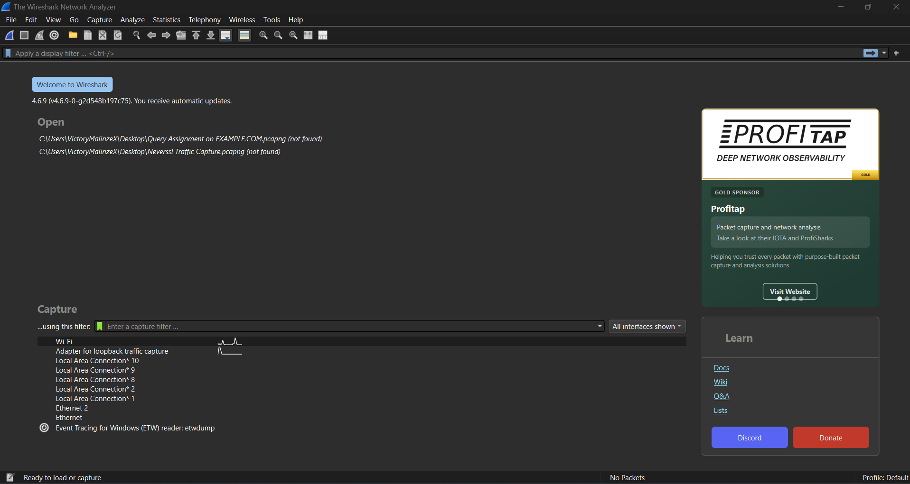

# Wireshark Practical: DNS Traffic Capture and Packet Analysis

## Introduction

As part of my cybersecurity and networking learning journey, I carried out a hands-on exercise using **Wireshark**, a network protocol analyzer, to capture, inspect, and analyze Domain Name System (DNS) traffic.

The purpose of this practical was to understand how DNS queries and responses work, identify the devices involved in DNS communication, and examine how domain names are resolved into IP addresses.

Rather than only learning networking concepts theoretically, this exercise allowed me to observe actual network packets and understand how devices communicate over a network.

## Objectives

The objectives of this practical were to:

- Understand how DNS works.
- Capture live network traffic using Wireshark.
- Generate DNS queries using the Windows Command Prompt.
- Identify DNS query and response packets.
- Understand the difference between A and AAAA DNS records.
- Identify source and destination IP addresses.
- Examine DNS packet details.
- Understand how DNS translates domain names into IP addresses.

## Tools and Technologies Used

| Tool | Purpose |
|---|---|
| Wireshark | Capturing and analyzing network packets |
| Windows Command Prompt | Executing network commands |
| `ipconfig` | Managing and inspecting Windows IP configuration |
| `nslookup` | Querying DNS servers |
| DNS | Resolving domain names into IP addresses |
| UDP | Transport protocol commonly used for DNS queries |

## Understanding DNS

**Domain Name System (DNS)** is a naming system that translates human-readable domain names into IP addresses that computers use to communicate over networks.

For example, when a user enters `example.com` into a browser, DNS helps locate the IP address associated with that domain.

Instead of remembering numerical IP addresses, users can access websites using domain names.

### Common DNS Record Types

| Record | Description |
|---|---|
| A | Maps a domain name to an IPv4 address |
| AAAA | Maps a domain name to an IPv6 address |
| CNAME | Maps an alias to another domain name |
| MX | Identifies mail servers for a domain |
| NS | Identifies authoritative name servers for a domain |

### Understanding A and AAAA Records

**A Record:** An A record maps a domain name to an IPv4 address.

**AAAA Record:** An AAAA record maps a domain name to an IPv6 address.

During this practical, I observed both A and AAAA DNS queries in Wireshark.

This happens because systems and applications may request both IPv4 and IPv6 addresses when attempting to establish network communication.

A DNS server may return an answer, return no matching record, or provide another response depending on the domain's DNS configuration.

## Practical Implementation

### Step 1: Opening Wireshark and Selecting a Network Interface

I opened Wireshark and examined the available network interfaces.

Since my computer was connected to the internet through Wi-Fi, I selected the Wi-Fi interface.

I double-clicked the interface to begin capturing live network traffic.

**Screenshot 1: Wireshark Network Interface Selection**



**Screenshot 2: Live Network Packet Capture**


### Step 2: Clearing the DNS Cache

I opened Windows Command Prompt and executed:

```cmd
ipconfig /flushdns
```

This command clears the local DNS resolver cache maintained by Windows.

Clearing the cache can help reduce the influence of previously cached local DNS entries when testing name resolution.

It does not clear the DNS cache maintained by the upstream DNS server.

The command returned a successful confirmation message.

**Screenshot 3: DNS Cache Successfully Flushed**


### Step 3: Generating DNS Traffic

Next, I executed:

```cmd
nslookup example.com
```

This command sends a DNS query requesting information about the domain `example.com`.

The output provided information about the DNS server being queried and the IP address or addresses returned for the domain.

The output helped me distinguish between:

- The DNS server address used to resolve the domain.
- The IP address returned for the requested domain.

**Screenshot 4: Nslookup Example.com**


### Step 4: Filtering DNS Traffic in Wireshark

After generating DNS traffic, I returned to Wireshark.

I entered the following display filter:

```wireshark
dns
```

This displayed DNS-related packets captured on the selected interface.

To narrow the results to queries involving `example.com`, I also used:

```wireshark
dns.qry.name == "example.com"
```

The filter helped me locate DNS packets associated with the domain.

**Screenshot 5: Wireshark DNS Display Filter**


### Step 5: Analyzing the DNS Query

I selected a DNS query packet marked:

`Standard query A`

I expanded the relevant packet details to inspect the network and DNS information.

The packet analysis included:

- Source IP address.
- Destination IP address.
- DNS query name.
- DNS query type.
- Transport protocol.

The A record query indicated that the client was requesting an IPv4 address associated with the domain.

I also observed AAAA queries, which request IPv6 address information.

**Screenshot 6: DNS Query Packet Analysis**


### Step 6: Analyzing the DNS Response

Next, I located the corresponding DNS response packet.

I selected the response and expanded the Domain Name System section, particularly the Answers section.

The DNS response provides the result of the original query.

For a successful A record response, the answer section contains an IPv4 address associated with the requested domain.

For a successful AAAA record response, the answer section contains an IPv6 address.

The query and response can be matched using their DNS transaction ID, alongside the queried name and record type.

**Screenshot 7: DNS Response Packet Analysis**


## 6. DNS Packet Analysis: Questions and Observations

The following questions guided my investigation.

| No. | Question | What to Identify |
|---|---|---|
| 1 | What is your computer's source IP address? | Source IP in the DNS query |
| 2 | What is the destination IP address? | Destination IP in the DNS query |
| 3 | Is the destination IP your DNS server? | Compare it with the DNS server shown by `nslookup` |
| 4 | What domain name did your computer request? | `example.com` |
| 5 | What DNS record type was requested? | A and/or AAAA |
| 6 | Can you find the DNS response? | Corresponding response packet |
| 7 | What IPv4 address did the DNS server return? | IPv4 address in the A record answer |

### My Practical Observations

**Source IP address:** `[Private client IP - redacted]`

**Destination IP address:** `[Private DNS server IP - redacted]`

**DNS server IP address:** `[Private DNS server IP - redacted]`

**Requested domain:** `example.com`

**DNS record types observed:** A and AAAA

**DNS response identified:** Yes

**IPv4 addresses returned (A records):** Two IPv4 addresses observed (redacted).

**IPv6 addresses returned (AAAA records):** Two IPv6 addresses observed (redacted).

**Transport protocol:** UDP

**Destination port:** `53`

**DNS transaction IDs observed:**
- A query and response: `0x0002`
- AAAA query and response: `0x0003`

The captured packets showed DNS queries travelling from my computer to the DNS server. The responses travelled in the opposite direction.

I successfully identified both A and AAAA queries and their corresponding responses using Wireshark.
*Note: The actual packet values should be documented from the captured traffic. A DNS query and its response are separate packets, and an AAAA query does not necessarily produce a successful IPv6 answer.*

## Important Wireshark Display Filters

These are useful display filters for DNS analysis:

| Display Filter | Purpose |
|---|---|
| `dns` | Displays DNS packets |
| `dns.qry.name == "example.com"` | Displays DNS queries for example.com |
| `dns.flags.response == 0` | Displays DNS query packets |
| `dns.flags.response == 1` | Displays DNS response packets |
| `dns.qry.type == 1` | Filters A record queries |
| `dns.qry.type == 28` | Filters AAAA record queries |

These filters make it easier to isolate specific DNS communications during network analysis.


## Conclusion

Completing this practical gave me a better understanding of how DNS works behind the scenes when devices communicate over a network.

Using Wireshark, I was able to capture live network traffic, generate DNS requests, filter DNS packets, and examine query and response information.

*This project was completed as part of my hands-on cybersecurity and networking learning journey.*

**Tools:** Wireshark | Windows Command Prompt | DNS | Networking
